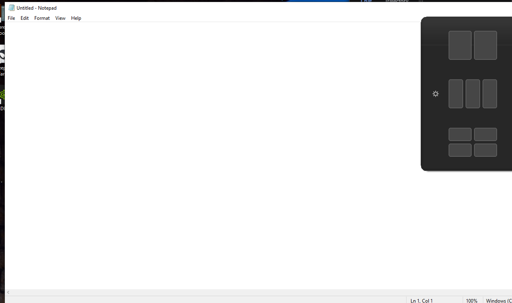

# SnapLayouts 10

**Snap Layouts neoficial pentru Windows 10.** Aplicația reproduce meniul din Windows 11: când
cursorul staționează aproximativ 300 ms pe butonul **Maximize** al ferestrei active, apare un meniu
cu șase modele de aranjare. Un click pe o zonă mută fereastra exact în acea zonă, fără scurtături de
tastatură și fără FancyZones.


> **Proiect neoficial.** Nu este afiliat, sponsorizat sau aprobat de Microsoft. „Windows”,
> „Snap Layouts” și „Snap Assist” sunt mărci ale Microsoft Corporation. Detalii în
> [NOTICE.md](NOTICE.md).

- Versiune: **1.3.0**
- Platformă: **Windows 10 22H2 x64**, .NET Framework 4.8
- Sistem testat: **Windows 10 IoT Enterprise 22H2, build 19045.6456**, Dell, 1920 × 1080, DPI 100%
- Limbă interfață: română
- Fără instalare, fără rețea, fără telemetrie



## Descărcare

Descărcați ultima versiune din secțiunea **Releases** a repository-ului GitHub:

- `SnapLayouts10.exe` — aplicația portabilă;
- `SnapLayouts10-1.3.0-portable.zip` — exe + documentație;
- `SnapLayouts10-1.3.0-source.zip` — codul sursă complet;
- `SHA256SUMS.txt` — verificare integritate.

În arhiva locală de dezvoltare, executabilul se află în `dist/`.

## Documentație

| Document | Conținut |
|----------|----------|
| [TESTARE.md](docs/TESTARE.md) | mediu, pași, rezultate, limitări |
| [COMPATIBILITATE.md](docs/COMPATIBILITATE.md) | aplicații testate și limitări |
| [ANALIZA-WINDOWS11.md](docs/ANALIZA-WINDOWS11.md) | analiza vizuală Windows 11 și decizii de design |
| [PUBLICARE-GITHUB.md](docs/PUBLICARE-GITHUB.md) | ghid de publicare și release |
| [CHANGELOG.md](CHANGELOG.md) | istoric versiuni |
| [CONTRIBUTING.md](CONTRIBUTING.md) | build, stil, testare, PR |
| [SECURITY.md](SECURITY.md) | raportare vulnerabilități și confidențialitate |

## Ce face

1. Detectează butonul Maximize al ferestrei active folosind `WM_NCHITTEST` (`HTMAXBUTTON`).
2. Afișează meniul după 300 ms de staționare a cursorului (valoare configurabilă).
3. Desenează șase machete cu 2, 3 sau 4 zone, în stilul Windows 11.
4. Evidențiază zona de sub cursor și ancorează fereastra la click.
5. Ține cont de monitorul pe care se află fereastra, de aria de lucru și de DPI.
6. Corectează marginile invizibile DWM, astfel încât ferestrele să fie aliniate vizual, cu un spațiu
   mic între ele.
7. Deschide **Snap Assist** pentru a completa și celelalte zone cu ferestrele deschise.
8. Rulează discret în System Tray, cu setări și pornire automată opțională.

## Modele de aranjare

| # | Model | Zone |
|---|-------|------|
| 1 | 2 coloane egale | 2 |
| 2 | 2 coloane 70/30 | 2 |
| 3 | 3 coloane egale | 3 |
| 4 | Stânga + 2 dreapta | 3 |
| 5 | 4 cadrane | 4 |
| 6 | Stânga mare + 3 dreapta | 4 |

Fiecare machetă are zonele ei active. În setări, modelele pot fi activate sau dezactivate individual.

## Instalare și pornire

Aplicația este portabilă și nu are nevoie de instalare.

1. Copiați `SnapLayouts10.exe` într-un folder permanent, de exemplu:
   `C:\Users\<utilizator>\AppData\Local\Programs\SnapLayouts10\`.
2. Rulați `SnapLayouts10.exe`. Va apărea iconița în System Tray.
3. Deschideți meniul iconiței cu click dreapta:
   - **Snap Layouts: activ** — pornește/oprește detectarea;
   - **Pornește cu Windows: da/nu** — scrie/șterge intrarea din `HKCU\...\Run`;
   - **Setări...** — întârziere, spațiere, Snap Assist, layout-uri active;
   - **Despre** și **Deschide folderul de date**.
4. Dublu-click pe iconiță deschide direct setările.

Pornirea cu parametrul `--settings` deschide setările imediat. Parametrul `--debug` activează
jurnalul detaliat (util pentru diagnosticare).

## Utilizare

1. Aduceți în prim-plan fereastra dorită (de exemplu Notepad, Explorer, Chrome).
2. Duceți cursorul pe butonul **Maximize** (pătratul din dreapta sus) și țineți-l nemișcat ~300 ms.
3. Alegeți o zonă din machetă.
4. Fereastra se mută în zona respectivă. Dacă Snap Assist este activ, puteți alege o altă fereastră
   pentru următoarea zonă; `Esc` anulează sesiunea.

Meniul dispare când cursorul iese din el, când fereastra își pierde focusul sau când se apasă
butonul Maximize.

## Setări

Fișierul de setări: `%APPDATA%\SnapLayouts10\settings.ini`

```ini
enabled=1
hoverdelayms=300
gap=8
snapassist=1
startwithwindows=0
firstrun=0
layouts=1,1,1,1,1,1
```

- `hoverdelayms` — 200…700 ms din interfață (1000 ms maximum în fișier).
- `gap` — spațiul dintre ferestre, 0…16 px din interfață.
- `layouts` — câte un `1`/`0` pentru fiecare dintre cele șase modele.

Jurnal: `%APPDATA%\SnapLayouts10\snap.log` (rotație automată la 256 KB).

## Cum funcționează

### Detectarea butonului Maximize

Aplicația rulează un timer de 40 ms. La fiecare tick:

1. citește poziția cursorului (`GetCursorPos`);
2. găsește fereastra de sub cursor (`WindowFromPoint` + `GetAncestor(GA_ROOT)`);
3. verifică dacă este fereastra activă, vizibilă și are `WS_MAXIMIZEBOX`;
4. trimite `WM_NCHITTEST` cu coordonatele cursorului și verifică rezultatul `HTMAXBUTTON (9)`.

Funcționează atât când fereastra este restaurată (buton **Maximize**), cât și când este maximizată
(buton **Restore Down**). În al doilea caz, fereastra este restaurată automat înainte de ancorare.

Dacă fereastra nu răspunde în 80 ms, se folosește o geometrie de rezervă în colțul din dreapta sus
(al treilea buton de titlu). Astfel aplicația nu blochează firul de input și nu depinde de hook-uri
globale de mouse.

### Afișarea meniului

După 300 ms, se calculează aria de lucru a monitorului (`MonitorFromPoint` + `GetMonitorInfo`) și
DPI-ul ferestrei (`GetDpiForWindow`). Meniul este un formular fără bordură, rotunjit, `TopMost` și
`WS_EX_NOACTIVATE`, ca să nu fure focusul ferestrei țintă. Se afișează sub butonul Maximize, cu
replasare deasupra dacă nu încape jos.

Machetele sunt desenate direct pe panou, fără carduri individuale, cu zone mari și rotunjite. În
partea stângă există o rotiță care deschide setările. Fundalul este o captură blurată a ecranului
din spate, peste care se aplică o tentă acrilică, apropiind aspectul de flyout-ul Windows 11.
Detalii și surse: [`docs/ANALIZA-WINDOWS11.md`](docs/ANALIZA-WINDOWS11.md).

### Ancorarea

Pentru fiecare zonă se calculează un dreptunghi în coordonate fizice. Se restaurează fereastra dacă
este maximizată/minimizată, apoi se aplică `SetWindowPos`. Diferența dintre `GetWindowRect` și
`DWMWA_EXTENDED_FRAME_BOUNDS` este compensată, altfel ferestrele ar rămâne cu margini invizibile
inegale. Spațiul dintre zone este împărțit simetric.

### Snap Assist vizual, în zona liberă

După prima ancorare nu apare un panou cu listă. Selectorul se deschide **direct în următoarea zonă
liberă** și afișează fereastra fiecărui candidat ca o **previzualizare plutitoare**, cu umbră, peste
desktopul blurat. Este modelul vizual din Snap Assist-ul Windows 11.

Previzualizările sunt randate de DWM (`DwmRegisterThumbnail` + `DwmUpdateThumbnailProperties`), deci
sunt live și păstrează proporțiile ferestrelor. Nu există titlu de dialog, listă de rânduri sau
carduri cu etichete; fereastra reală este elementul vizual. Un click pe o previzualizare o ancorează
în acea zonă, apoi selectorul se mută automat în următoarea zonă liberă.

Grilă se adaptează formei zonei: 2 × 3 pe o jumătate de ecran, 3 × 2 într-un cadran sau într-o zonă
îngustă. Dacă previzualizarea live nu poate fi creată, se afișează iconița mare a aplicației.
Sesiunea poate fi anulată cu `Esc` sau printr-un click în afara zonei. Până la șase ferestre sunt
afișate simultan.

### Monitoare multiple

Aria de lucru, DPI-ul și poziționarea meniului sunt calculate pentru monitorul de sub cursor, nu
pentru monitorul primar. Ancorarea folosește tot aria monitorului țintă. Sunt folosite API-uri
per-monitor (`GetDpiForWindow`, `MonitorFromPoint`), iar manifestul declară `PerMonitorV2`.

## Compilare din sursă

Necesită doar componentele incluse în Windows 10:

- `C:\Windows\Microsoft.NET\Framework64\v4.0.30319\csc.exe`
- .NET Framework 4.8 (inclus în Windows 10 22H2)
- Windows PowerShell 5.1

```powershell
powershell.exe -NoProfile -ExecutionPolicy Bypass -File .\build.ps1
```

Rezultatul este `dist\SnapLayouts10.exe`. Scriptul generează și iconița `assets\app.ico` dacă lipsește.
Nu se descarcă nimic din rețea.

Teste geometrice automate:

```powershell
powershell.exe -NoProfile -ExecutionPolicy Bypass -File .\tools\test-geometry.ps1
```

Pachete de release:

```powershell
powershell.exe -NoProfile -ExecutionPolicy Bypass -File .\package.ps1
```

CI-ul din `.github/workflows/build.yml` rulează build-ul, testele și pachetarea pe `windows-latest`.
Workflow-ul `release.yml` publică automat release-ul la un tag `v*`. Instrucțiuni:
[PUBLICARE-GITHUB.md](docs/PUBLICARE-GITHUB.md).

## Structura proiectului

```
SnapLayouts10/
├── .github/
│   ├── workflows/             # build CI + release automat
│   ├── ISSUE_TEMPLATE/
│   └── PULL_REQUEST_TEMPLATE.md
├── build.ps1                  # compilare csc
├── package.ps1                # pachete portable/sursă + SHA-256
├── README.md
├── LICENSE
├── NOTICE.md
├── CHANGELOG.md
├── CONTRIBUTING.md
├── SECURITY.md
├── assets/app.ico
├── dist/                      # generat local, ignorat de Git
├── docs/
│   ├── TESTARE.md
│   ├── COMPATIBILITATE.md
│   ├── ANALIZA-WINDOWS11.md
│   ├── PUBLICARE-GITHUB.md
│   └── preview-flyout.png
├── src/
│   ├── Program.cs            # pornire, instanță unică, excepții
│   ├── TrayApp.cs            # System Tray, meniu, sesiune Snap Assist
│   ├── HoverWatcher.cs       # polling, detectare Maximize, poziționare meniu
│   ├── SnapFlyout.cs         # meniul grafic cu șase machete
│   ├── SnapEngine.cs         # calcule de zone, SetWindowPos, enumerare ferestre
│   ├── SnapAssistForm.cs     # selector vizual cu previzualizări DWM
│   ├── SettingsForm.cs       # setări, comutatoare, machete
│   ├── Layouts.cs            # definițiile celor șase layout-uri
│   ├── AppSettings.cs        # citire/scriere setări
│   ├── AutoStart.cs          # HKCU Run
│   ├── Native.cs             # P/Invoke
│   ├── Theme.cs              # culori Windows 11, temă clară/întunecată
│   ├── Util.cs               # DPI, dreptunghiuri, monitor
│   ├── IconFactory.cs        # iconița din tray
│   ├── Log.cs
│   └── app.manifest          # PerMonitorV2, asInvoker
└── tools/
    ├── make-icon.ps1
    └── test-geometry.ps1
```

## Testare

Rezultatele și pașii sunt în [`docs/TESTARE.md`](docs/TESTARE.md). Testul geometric automat:

```powershell
powershell.exe -NoProfile -ExecutionPolicy Bypass -File .\tools\test-geometry.ps1
```

Pe mașina de test:

- detectarea butonului Maximize a funcționat pentru Notepad și Chrome (`WM_NCHITTEST = 9`);
- meniul a apărut la ~360–430 ms de la primul tick care a identificat butonul;
- ancorarea în 2 coloane, 70/30, 3 coloane și 4 cadrane a produs dreptunghiuri vizibile corecte;
- Snap Assist s-a deschis direct în zona liberă, cu până la 6 previzualizări plutitoare live DWM
  peste desktopul blurat, și a ancorat fereastra aleasă vizual în acea zonă;
- setările, combo-urile dark, salvarea și iconița din tray au fost verificate;
- activarea/dezactivarea pornirii automate a scris/șters corect valoarea din `HKCU\...\Run`.

## Limitări cunoscute

- Ferestrele care nu răspund la `WM_NCHITTEST` cu `HTMAXBUTTON` și au titlu desenat complet custom
  pot să nu fie detectate. Majoritatea aplicațiilor Windows (Notepad, Explorer, Chrome, Electron)
  funcționează.
- Ferestrele aplicațiilor rulate cu drepturi de administrator pot refuza mutarea dintr-un proces
  normal (UIPI). Dacă aveți nevoie de ele, rulați SnapLayouts 10 ca administrator.
- Testarea multi-monitor s-a făcut prin proiectare și API-uri per-monitor; pe mașina de test a
  existat un singur monitor. Nu există dependențe de monitorul primar.
- Snap Assist afișează maximum 6 ferestre, aranjate dinamic în zona liberă. Dacă sunt mai multe,
  sunt luate primele șase în ordinea Z-order.
- Previzualizările depind de DWM; pentru ferestrele care nu permit thumbnail DWM se afișează iconița
  mare a aplicației.
- Executabilul **nu este semnat digital**. Windows SmartScreen poate afișa un avertisment la prima
  rulare. Verificați hash-ul din `SHA256SUMS.txt` sau compilați din sursă.
- Nu funcționează pe Windows 7/8; este țintit Windows 10 22H2 x64 (și rulează și pe Windows 11).

## Confidențialitate

Aplicația nu are rețea, telemetrie sau actualizări automate. Scrie doar:

- `%APPDATA%\SnapLayouts10\settings.ini`
- `%APPDATA%\SnapLayouts10\snap.log`
- opțional, la cerere, `HKCU\Software\Microsoft\Windows\CurrentVersion\Run\SnapLayouts10`

Jurnalul poate conține titluri de ferestre. Înainte de a-l publica într-un issue, eliminați datele
personale. Detalii: [SECURITY.md](SECURITY.md).

## Contribuții

Contribuțiile sunt binevenite. Citiți [CONTRIBUTING.md](CONTRIBUTING.md) și
[CODE_OF_CONDUCT.md](CODE_OF_CONDUCT.md). Pentru vulnerabilități, folosiți
[SECURITY.md](SECURITY.md), nu un issue public.

## Licență

[MIT](LICENSE) © 2026 SnapLayouts 10 contributors.

Proiect neoficial; consultați [NOTICE.md](NOTICE.md).
